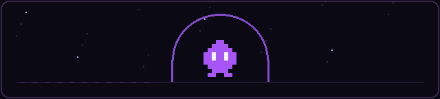
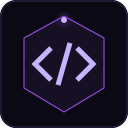
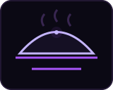
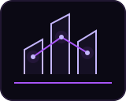
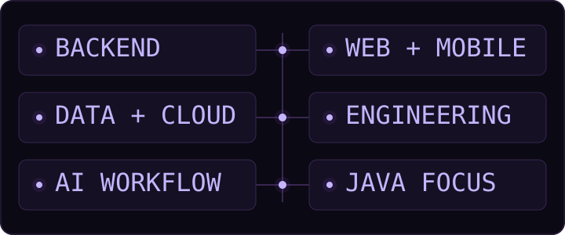

# Michele Andrade

**Software Engineer · Backend & Full-Stack** 
Engineering with logic. Creating with imagination.

[LinkedIn](https://www.linkedin.com/in/michele-andrade-dev/) · [Portfolio](https://micheleandrade.dev/) · [Main quests](#02--main-quests)

**MICHELE.DEV // BUILD QUEST** 
Java · Spring Boot · TypeScript · Node.js · AI-assisted development

Play the start-screen animation · optional motion

Four-second loop, without rapid flashes. The page stays still while this panel is closed. The companion is an original concept study, **not the established Nina design**.

## 01 / Player profile

I build web and mobile applications, REST APIs, integrations and business systems. My professional experience centers on **TypeScript, Node.js, NestJS, React, React Native and PostgreSQL**, with AWS and Docker.

I am deepening my practice with **Java and Spring Boot**, focusing on domain modeling, backend architecture, security, persistence and automated testing.

**Based in Brazil.** Open to opportunities in Brazil, international remote work and European relocation, especially Portugal and Spain.

## 02 / Main quests

*Original conceptual emblems below; these are not product screenshots. All three projects are in development.*

### [Sabli](https://github.com/michelesilva20/sabli) / Restaurant SaaS

Restaurant SaaS under development at **Emilabs**. The main branch currently contains a frontend demonstration; **Java/Spring Boot** backend work and integrations are under review in development branches.

[Explore Sabli →](https://github.com/michelesilva20/sabli)

### [Nivva](https://github.com/michelesilva20/nivva) / Personal finance

A mobile application and Java backend for accounts, income, expenses and goals.

**Java 21 · Spring Boot · PostgreSQL · React Native · Expo · TypeScript**

User-owned data, integer-cent amounts, derived balances, repository adapters and concurrency control for goal contributions. JUnit/Testcontainers and TypeScript tests support the implementation.

**Current scope:** accounts, transactions and goals can use the API; monthly budgets remain on-device. AI insights, Open Finance and cloud deployment are future work.

[Explore Nivva →](https://github.com/michelesilva20/nivva)

### [Nexum Tower](https://github.com/michelesilva20/Nexum-Tower) / Logistics platform

A full-stack platform for multi-tenant administration and logistics master data: branches, customers, locations, drivers, vehicles and routes.

**Next.js · NestJS · TypeScript · PostgreSQL · Prisma**

Tenant and branch access boundaries, RBAC/ABAC, cookie-based authentication, audit records, service tests and CI.

**Current scope:** the operational dashboard uses demonstration data. Shipment/trip execution and product AI are future work; database isolation has deployment validation gates.

[Explore Nexum Tower →](https://github.com/michelesilva20/Nexum-Tower)

Side quests · education, interfaces and product exploration

**[Eduvy](https://github.com/michelesilva20/eduvy)** — Courses, cohorts, enrollments, progress and assessments. Next.js, NestJS, TypeScript, PostgreSQL, Prisma and Redis/BullMQ; tenant-aware data access, assessment rules, transactional outbox infrastructure, database tests and CI. In development, with no commercial deployment or generative AI functionality claimed.

**[Luméa Beauty](https://github.com/michelesilva20/lumea-beauty)** — Beauty storefront, reusable components and responsive visual design.

**[RotaFlux](https://github.com/michelesilva20/rotaflux)** and **[RedaçãoLab](https://github.com/michelesilva20/redacaolab)** — Logistics and education workflow explorations.

Luméa Beauty, RotaFlux and RedaçãoLab are **frontend prototypes with demonstration data**.

## 03 / Skill tree

- **Backend / professional experience:** Node.js, NestJS, TypeScript, REST APIs and integrations.
- **Java focus / deepening specialization:** Java, Spring Boot, domain modeling and backend architecture.
- **Web + mobile:** React, React Native, TypeScript and JavaScript.
- **Data + cloud:** PostgreSQL, SQL, AWS and Docker.
- **Engineering:** Git, automated testing, API contracts, security, documentation and CI/CD workflows.
- **AI workflow:** generative AI for requirements, implementation, debugging, review, tests and documentation.

## 04 / AI module

**AI accelerates the workflow. Engineering judgment stays human.**

Requirements analysis → planning → implementation → debugging → refactoring → testing → code review → documentation.

I use AI as an engineering tool. Technical decisions, critical review, security and validation remain my responsibility.

Development assistance and product AI

AI assistance during development is distinct from AI inside a product. My private **NINA** project includes a backend OpenAI integration; its code is not publicly available for review. Nivva's intelligent insights remain planned. The NINA software project is separate from the companion concept artwork on this page.

## 05 / Journey

- **Degree in Systems Analysis and Development** — FATEC Botucatu.
- **MBA in Data Science, Artificial Intelligence and Analytics** — USP/ESALQ, in progress.

## 06 / Continue the journey

**Let's build something meaningful.**

[LinkedIn](https://www.linkedin.com/in/michele-andrade-dev/) · [Portfolio](https://micheleandrade.dev/) · [Public repositories](https://github.com/michelesilva20?tab=repositories)

Em português

Sou Software Engineer com experiência em sistemas web e mobile, APIs e integrações, principalmente com TypeScript, Node.js/NestJS e React/React Native. Aprofundo Java e Spring Boot com foco em backend, arquitetura, segurança e testes. Uso IA com revisão e responsabilidade técnica. Sabli e Nivva orientam minha evolução de produto; os projetos públicos acima permitem explorar evidências de código e documentação. Busco oportunidades no Brasil, trabalho remoto internacional e possibilidades de realocação para a Europa.

